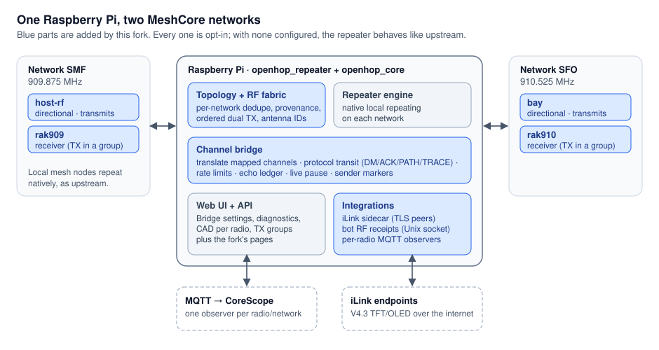

# OpenHop Repeater: HydraHop fork

This is Kesh's fork of [OpenHop Repeater](https://github.com/openhop-dev/openhop_repeater), the Python MeshCore repeater daemon. It runs one repeater on a Raspberry Pi across **two MeshCore networks on different frequencies**. It bridges selected traffic between them, takes in packets from extra receive-only radios, and keeps native local repeating on each network unchanged.



Everything the fork adds is **opt-in**. With none of the fork's configuration sections present, the daemon behaves like upstream.

| | |
|---|---|
| **Main line** | [`kesh/bridge`](https://github.com/kesh33w/openhop_repeater/tree/kesh/bridge): what runs in production |
| **Current release** | `kesh-2026.11.18`: see [CHANGELOG.md](CHANGELOG.md) |
| **Upstream base** | `openhop-dev/openhop_repeater` `dev` at `72266e2` (27 Oct 2026): see [syncing with upstream](docs/fork/upstream-sync.md) |
| **Upstream docs** | [UPSTREAM-README.md](UPSTREAM-README.md): installers, radio support, dashboard, plugins |

## What this fork changes

Full reference, with every config key and default: **[docs/fork/README.md](docs/fork/README.md)**.

| Area | Change | Default |
|---|---|---|
| **Bridging** | [Channel translation](docs/fork/README.md#channel-translation) decrypts an authorised channel on one network and re-encrypts it for a mapped channel on the other. | Off |
| | [Protocol transit](docs/bridge-protocol-routing.md): DMs, ACKs, discovery, repeater admin and TRACE cross on explicit routes, unchanged and still encrypted. | Off |
| | [Bridge safeguards](docs/bridge-reception-evidence.md): per-direction rate limits, bounded queues, durable echo ledger, live pause. | On when the bridge is |
| | [Sender markers](docs/bridge-text-markers.md) such as `↔ Dan: hello` on translated messages. | Off |
| **Multi-radio** | [Network topology](docs/logical-receivers.md): two logical networks, one designated transmitter each, extra `receiver` and `shadow` radios. | Off |
| | [Ordered dual TX](docs/ordered-dual-tx.md): send one logical packet through two antennas in turn, either for every packet or [for bridged packets only](docs/ordered-dual-tx.md#bridged-packets-only). | Off |
| | [Antenna identities](docs/tx-identities.md): our flood hop names which antenna heard a packet and which sent it. | Off |
| **Radio** | [Per-radio CAD on/off](docs/cad-mode.md) and [per-radio CAD calibration](docs/per-radio-cad.md), set after a firmware acknowledgement. | Unchanged |
| **Observability** | [Per-radio MQTT observer identities](docs/separate-observer-identities.md), per-radio RF receive age, [bridge diagnostics](docs/fork/bridge-api.md#diagnostics). | Off |
| | [Independent reception evidence](docs/bridge-reception-evidence.md): allowlisted outside receivers confirm a crossing was heard. | Off |
| **Integrations** | [Internet Link (iLink)](docs/fork/README.md#internet-link-ilink) hooks for the TLS sidecar in [kesh-openhop-bridge](https://github.com/kesh33w/kesh-openhop-bridge). | Off |
| | [Bot RF receipts](docs/bot-rf-receipts.md): an authenticated local stream for a chat bot's raw RF fallback. | Off |

The fork also carries fixes to upstream behaviour that its features depend on: radio provenance, transmit outcomes, config saving and more. These are listed in the [CHANGELOG](CHANGELOG.md).

## The stack

The repeater is one of four repositories released together under the same tag. The [project hub](https://github.com/kesh33w/kesh-openhop-bridge) pins the exact commits that are tested together.

| Repository | Branch | Role |
|---|---|---|
| **openhop_repeater** (this repo) | `kesh/bridge` | Daemon: routing, bridge, multi-radio, web API, bundled web UI |
| [openhop_core](https://github.com/kesh33w/openhop_core) | `kesh/bridge` | MeshCore library: radio drivers, RF fabric, topology, dispatcher |
| [openHop_RepeaterUI](https://github.com/kesh33w/openHop_RepeaterUI) | `kesh/bridge` | Vue web UI source. It builds into `repeater/web/html` here. |
| [kesh-openhop-bridge](https://github.com/kesh33w/kesh-openhop-bridge) | `kesh/openhop-bridge` | Hub: Internet Link sidecar, enrollment, component pins, firmware releases, upgrade guide |

`pyproject.toml` depends on `kesh33w/openhop_core@kesh/bridge`. Upstream core lacks modules this fork imports, such as `rf_fabric.topology`.

## Install, upgrade and test

- **Deploying to a Pi:** follow the hub's [upgrade guide](https://github.com/kesh33w/kesh-openhop-bridge/blob/kesh/openhop-bridge/docs/upgrade.md). The upstream installers, Docker images and web updater in the upstream README are not verified for this fork.
- **Developing:** see [CONTRIBUTING.md](CONTRIBUTING.md). In short:

```sh
python3 -m venv .venv
.venv/bin/pip install -e '.[dev]'
.venv/bin/pre-commit run --all-files   # ruff, format, bandit, OpenAPI contract, full test suite
```

CI runs the same gate on every pull request and every push to `kesh/bridge`.

## Security

Channel keys are write-only through the API. The bridge necessarily handles plaintext while translating between channels with different keys, so translated traffic is **not end-to-end encrypted**. Channel authentication does not identify an individual sender. See [SECURITY.md](SECURITY.md) for how to report a problem.

## Upstream and license

This fork builds on [OpenHop Repeater](https://github.com/openhop-dev/openhop_repeater) and [OpenHop Core](https://github.com/openhop-dev/openhop_core). It remains under the [MIT License](LICENSE). Credits for the wider system are in the hub's [NOTICE](https://github.com/kesh33w/kesh-openhop-bridge/blob/kesh/openhop-bridge/NOTICE.md).

Report fork-specific problems in the [hub's issues](https://github.com/kesh33w/kesh-openhop-bridge/issues), which cover all four repositories of this fork. Include the commit and steps to reproduce, and leave out channel keys and credentials.
