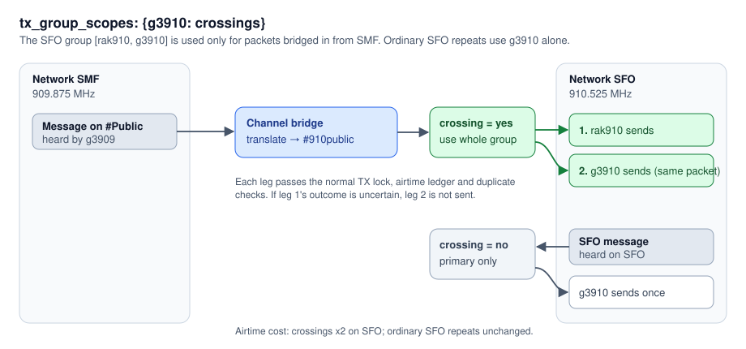

# Optional ordered physical transmissions

The Bridge page can stage an ordered transmitter group for a logical network.
Choose the existing primary alone to retain single TX, or primary plus a second
radio in either order. For SF Sac Bridge, the intended choices are directional
then RAK, or RAK then directional. Changes require restart and are not applied to
the live radios by saving the form.

Requires the matching openhop_core `kesh/bridge` (release `kesh-2026.11.18` or later). Example:

```yaml
fabric:
  topology:
    networks: {SMF: g3909, SFO: g3910}
    tx_groups:
      g3910: [rak910, g3910]
```

## Bridged packets only



To double-transmit only the traffic the bridge carries across, scope the group to crossings:

```yaml
fabric:
  topology:
    tx_groups:
      g3910: [rak910, g3910]
    tx_group_scopes:
      g3910: crossings        # default: all
```

- **Bridged copies** go out through every radio in the group, in order. These are translated channel messages and protocol transit (DM, ACK, PATH, TRACE) sent from the other network.
- **Everything else** on that network uses the primary alone, so local airtime does not double. That covers native repeats, replies and messages this node originates.
- The same safeguards apply as for a full group: each leg goes through the TX lock, airtime ledger and duplicate checks, and an uncertain first leg stops the second.
- In the web UI, choose a transmitter pair under **Bridge settings → Sequential transmitters**, then pick **Both transmitters for bridged packets only**. Save, then restart.
- A scope only applies to a two-radio group. Saving a single transmitter clears it.

## Notes

Omit `tx_groups` to retain existing behavior. Receiver/shadow roles remain
unchanged: membership grants a physical TX only inside an intentional group, not
independent routing, replies, or forwarding. Both radios must have matching RF
settings. Existing CAD/LBT and power settings are left unchanged. No extra CAD
check is added by the group; normal per-radio send behavior remains in place.
CAD may delay a leg, but the next leg still waits for completion; a missing
completion aborts the remaining legs. This version has no group CAD option.

## Behavior and evidence

- A logical packet is normalized once, then identical bytes are sent sequentially.
- Each leg uses the normal TX lock, deadline/pause checks, local echo tracking,
  and shared frequency/bandwidth airtime ledger. The second leg consumes airtime.
- A confirmed or definitely-unsent first leg permits the second. An uncertain
  completion, exception, or cancellation prevents further sends. Suppressed
  logical duplicates stop the whole group without inventing uncertainty.
- Existing definitely-unsent retry rules apply; missing modem acknowledgement
  is never treated as permission to resend.
- Packet egress records contain physical radio, success, failure reason and raw
  bytes per leg. Aggregate success means **at least one** leg confirmed; it does
  not claim both succeeded. Partial success plus uncertain completion retains
  both facts. Cancellation preserves completed leg results.
- Existing protocol ACK redundancy is retained: each scheduled logical ACK copy
  can use its configured group. This does not promise exactly two RF frames for
  an entire transaction containing multiple protocol ACK copies.
- Ordinary Core/Dispatcher direct calls are not automatically fanned out. The
  repeater's scheduled relay/local/bridge paths expand the group; emergency
  startup fallback paths without the normal router injector remain single TX.

## Rollout status

Implementation is opt-in and tested with simulated radios. No production
configuration, CAD setting, power setting or radio firmware was changed, and no
RF test packets were transmitted. Install Core, repeater and UI together before deliberately enabling a group. A radio/TX timeout
cannot prove reception elsewhere: independent RX evidence remains separate.
